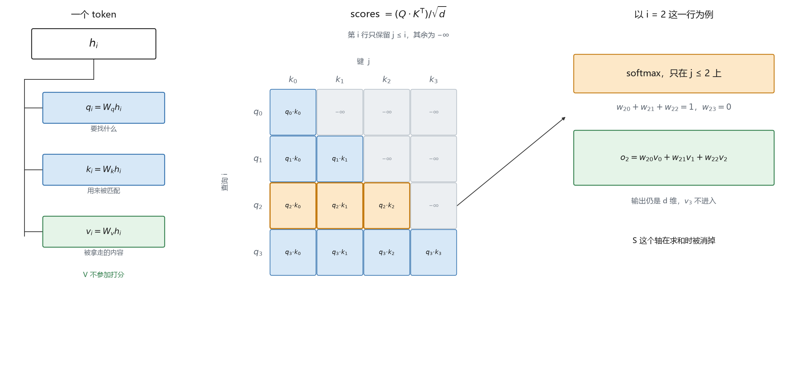
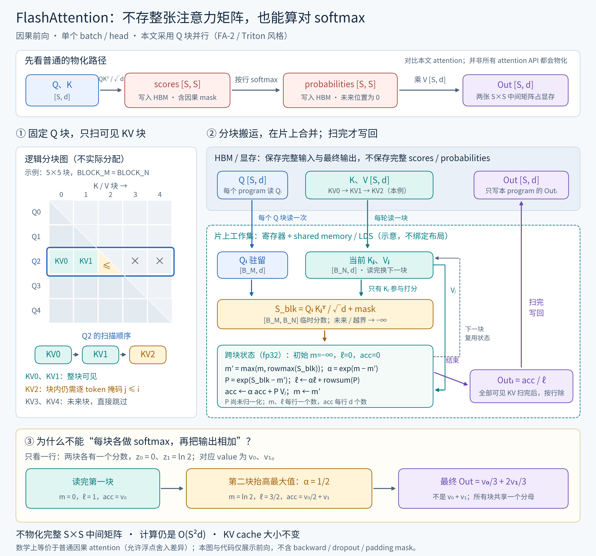
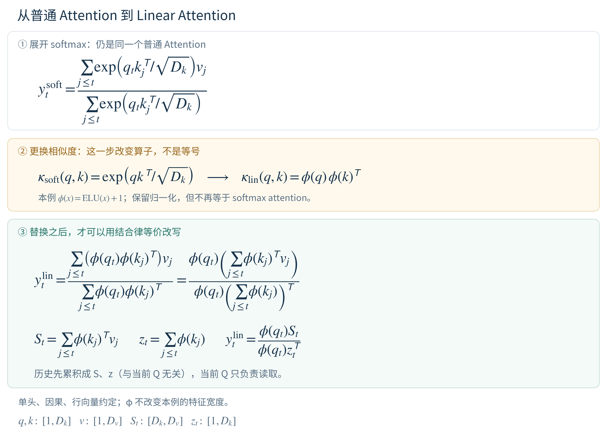
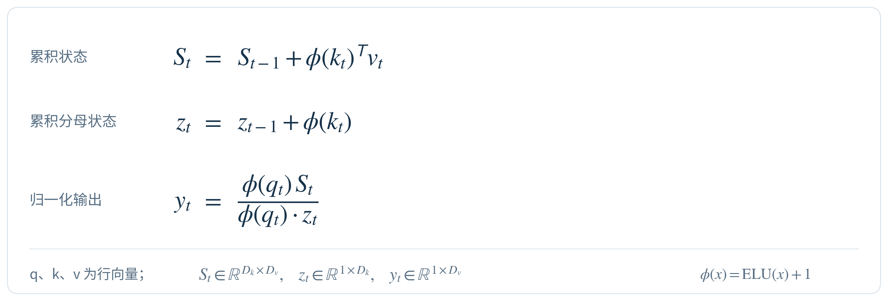
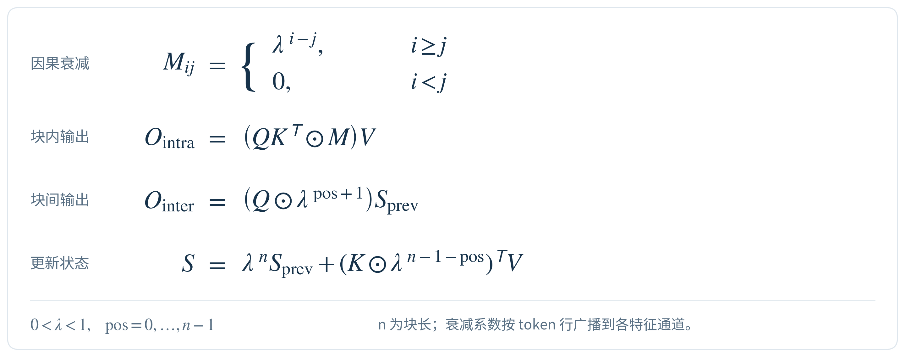

# 一文读懂 Attention：MHA、GQA、FlashAtt、MLA 与 LinearAtt

因果自注意力：第 i 个 token 只用自己的 Q 去和 j≤i 的 K 做点积，softmax 后加权这些位置的 V。序列长度 S、头宽 d 时，分数矩阵仍是 **S×S**，上三角在进 softmax 之前是 -inf。缩放是 `1/sqrt(d)`。

softmax 把一行分数 z 变成和为 1 的非负权重；有限分数对应的权重在精确算术下为正，掩码项为 0。这里假设每行至少有一个有限分数。分母是这一行所有 exp 的和：

```text
softmax(z)_j = exp(z_j) / Σ_k exp(z_k)
Σ_j softmax(z)_j = 1
```

写成 -inf 的项，exp 之后是 0，不进入分母。只剩两个有限分数 a、b 时，上式收成这两个分数各自的权重：

```text
w_a = exp(a) / (exp(a) + exp(b)) = 1 / (1 + exp(-(a - b)))   # a 的权重
w_b = exp(b) / (exp(a) + exp(b)) = 1 - w_a                     # b 的权重
```

```text
scores = (Q @ K.T) / sqrt(d)          # [S, d] @ [d, S] -> [S, S]
scores = mask(scores, j > i, -inf)    # 第 i 行只能看见 j≤i
out    = softmax(scores) @ V          # [S, S] @ [S, d] -> [S, d]
```



图中网格为简洁只标 `q_i · k_j`，有效分数统一还要除以 `sqrt(d)`；`i=2` 使用从 0 开始的下标。图中的输出宽 d 假设 V 宽也为 d。

先看一头。Q、K、V 都是 `[S, d]`，但三个矩阵做的事不一样。同一个 token 的隐状态 h_i 用三套权重投出去：

```text
q_i = Wq h_i    # 我要找什么
k_i = Wk h_i    # 别人拿什么来匹配我
v_i = Wv h_i    # 匹配上之后被拿走的内容
```

`(Q @ K.T)` 的第 i 行第 j 列是一个标量 `q_i · k_j`：第 i 个 token 用自己的查询，去对第 j 个 token 的键。打分只用 Q 和 K。V 不参加比较，只在权重出来之后被加进去。所以「像不像」和「拿走什么」是分开的两件事，K 和 V 可以完全不同。

第 i 行里，j>i 的位置已经是 -inf，softmax 之后权重是 0，不进入求和。剩下 j≤i 的分数变成和为 1 的权重，再对对应的 V 行求加权平均。S 这个轴被加掉，输出第 i 行仍是 d 维，而且只含当前位置和过去的 V。每个位置的输出长度等于 V 的宽度，不等于序列长度。

```text
w_ij = softmax_{j≤i}(q_i · k_j / sqrt(d))
o_i  = sum_{j≤i} w_ij v_j
```

`/sqrt(d)` 用来抑制点积尺度随头宽增长，从而降低 softmax 过度尖锐、梯度变小的风险；它不保证任意输入下都不会饱和。设各分量独立，q 与 k 也独立：

```text
E[q_m] = 0,   Var(q_m) = 1
E[k_m] = 0,   Var(k_m) = 1

s = q·k = Σ_m q_m k_m
E[s] = 0,     Var(s) = d          # Var(q_m k_m) = E[q_m²]E[k_m²] = 1，d 项相加

E[s / sqrt(d)] = 0,   Var(s / sqrt(d)) = 1
```

若这些乘积项还满足中心极限定理的条件（例如独立同分布且方差有限），d 较大时 `s / sqrt(d) ≈ N(0, 1)`；这不是对实际模型 Q/K 分布的保证。两项时用上面的 `w_a`。d=128 时 `sqrt(Var(s)) = sqrt(128) ≈ 11`。取两个落在这个幅度附近的分数 a=12、b=8，分差是 4：

```text
不缩放:        1 / (1 + exp(-4))             ≈ 0.98 / 0.02
除以 sqrt(d):  1 / (1 + exp(-4/sqrt(128)))   ≈ 0.59 / 0.41
除以 d:        1 / (1 + exp(-4/128))         ≈ 0.51 / 0.49
```

不缩放时，分差 4 直接进了 exp，权重收成 0.98 对 0.02。除以 sqrt(d) 之后分差变成 4/11，方差回到上面的 1，两个分数都还分得到权重。除以 d 则把分差收成 4/128，方差变成 1/d，权重又挤回 0.5 附近。

多头把模型隐状态（宽 D）投影到 H 个子空间，每头宽 d，各自做上面这套，再拼回去；常见配置是 H×d=D，但不是硬性要求。每一头有自己的 Wq、Wk、Wv，点积发生在不同的子空间里，可以匹配不同的关系。每一头都带同一个因果掩码。后面的 MHA/GQA/MLA 改投影与缓存组织，FlashAttention 改计算方式，它们仍做因果 softmax 加权平均；再后面的 Linear/Lightning/GLA/KDA 则改变注意力算子，不与 softmax attention 数学等价，也不一定是归一化的加权平均。

> 代码范围：下面是便于核对公式的教学示例，各 Python 代码块按顺序执行。输入为同设备、同 dtype、非空的整段序列；代码不含 dropout、padding mask、KV-cache 更新或位置偏移。缓存大小默认按单层、单条序列统计，只计元素数，不含实现元数据；换算字节数还需乘每个元素的存储字节数。除明确标注的 Triton 前向外，PyTorch 示例可自动求导，但不是高性能实现。

## MHA（Multi-Head Attention）

MHA 为 H 个 query 头分别配备各自的 K/V 投影，而不是必须使用某种位置编码。本例选择把 RoPE 打在每头 Q/K 的全部 d 个通道上，并显式物化分数矩阵；实际 MHA 也可使用其他位置编码、partial RoPE 或 FlashAttention。[1][2]

```text
Q = RoPE(Wq h)    # [B, S, H, d]
K = RoPE(Wk h)
V = Wv h
```

RoPE 不把位置拼到向量后面，而是按位置旋转 Q 和 K。头宽 d 拆成 d/2 对，第 m 对在位置 pos 上转过的角度是 `pos / 10000^{2m/d}`。固定未旋转的 Q、K 时，点积中的位置影响只跟相对距离 i−j 有关；给所有位置同时加一个偏移，分数不变。本例不对 V 施加 RoPE，所以这一旋转操作直接作用于打分，而非 V；这不表示 V 或输入隐状态本身不含位置信息。这里用 base=10000、配对 `(m, m+d/2)` 的 half-split 实现；RoPE 也有相邻通道配对等布局，权重必须与布局匹配。

```python
import torch
import torch.nn as nn


def rope(x):
    # x: [B, S, H, D]，D 为偶数。只旋转最后一维。
    s, d = x.shape[-3], x.shape[-1]
    if d <= 0 or d % 2:
        raise ValueError("RoPE requires a positive even head dimension")
    half = d // 2
    pos = torch.arange(s, device=x.device)
    inv_freq = 1.0 / (10000 ** (torch.arange(half, device=x.device, dtype=torch.float32) / half))
    angles = pos[:, None] * inv_freq[None, :]
    cos = angles.cos().view(1, s, 1, half)
    sin = angles.sin().view(1, s, 1, half)
    x1, x2 = x[..., :half], x[..., half:]
    # 频率用 fp32 算；返回输入 dtype，避免 Q/K 变 fp32 而 V 仍是半精度。
    return torch.cat((x1 * cos - x2 * sin, x2 * cos + x1 * sin), dim=-1).to(x.dtype)


def attention(q, k, v):
    # q, k: [B, H, S, Dk]，v: [B, H, S, Dv]。分数矩阵直接落地。
    s = q.shape[-2]
    work_dtype = torch.float32 if q.dtype in (torch.float16, torch.bfloat16) else q.dtype
    qf, kf, vf = (t.to(work_dtype) for t in (q, k, v))
    scores = torch.matmul(qf, kf.transpose(-2, -1)) * (q.shape[-1] ** -0.5)
    pos = torch.arange(s, device=q.device)
    scores = scores.masked_fill(pos[None, :] > pos[:, None], float("-inf"))
    return torch.matmul(torch.softmax(scores, dim=-1), vf).to(v.dtype)


class MultiHeadAttention(nn.Module):
    def __init__(self, dim, n_heads, head_dim):
        super().__init__()
        self.n_heads, self.head_dim = n_heads, head_dim
        self.wq = nn.Linear(dim, n_heads * head_dim, bias=False)
        self.wk = nn.Linear(dim, n_heads * head_dim, bias=False)
        self.wv = nn.Linear(dim, n_heads * head_dim, bias=False)
        self.wo = nn.Linear(n_heads * head_dim, dim, bias=False)

    def forward(self, x):
        b, s, _ = x.shape
        h, d = self.n_heads, self.head_dim
        q = rope(self.wq(x).view(b, s, h, d))
        k = rope(self.wk(x).view(b, s, h, d))
        v = self.wv(x).view(b, s, h, d)
        # 解码缓存: k, v → [B, S, H, d] 各一份
        y = attention(q.transpose(1, 2), k.transpose(1, 2), v.transpose(1, 2))
        return self.wo(y.transpose(1, 2).reshape(b, s, h * d))
```

沿用 `q = Wq h` 的列向量约定，合并所有头后的 `Wq/Wk/Wv` 各是 **(H×d)×D**，`Wo` 是 **D×(H×d)**；这也对应 PyTorch `nn.Linear.weight` 的 `[out_features, in_features]` 布局。单头的 `Wq` 才是 d×D。若把 token 按行堆成 X，则写成 `Q = X @ Wq.T`。这里不含 bias，四个线性投影的参数量是 **4 × D × H × d**。

解码时历史 token 的 K、V 都要留着，每个 token 是 **2 × H × d** 个数。总缓存为 **S × 2 × H × d** 个数；它随 S 增长，在头宽 d 固定时也随 H 线性增长。

## GQA（Grouped-Query Attention）

Q 仍然是 H 头。K、V 只投影 `n_kv_heads` 头，`H` 必须能被 `n_kv_heads` 整除。一组里有 `n_rep = H / n_kv_heads` 个 query 头。本教学实现先把每份 K、V 在头维重复 `n_rep` 次，复用 MHA 的 matmul；这不是 GQA 必须的复制步骤，原生 GQA kernel 可以直接读取共享的 KV 头。[3]

`n_kv_heads = H` 时就是上一节；`n_kv_heads = 1` 时是 MQA（Multi-Query Attention），所有 query 头共用一份 K、V。

```text
Q = RoPE(Wq h)                 # [B, S, H, d]
K = RoPE(Wk h)                 # [B, S, n_kv_heads, d]
V = Wv h
K = repeat(K, n_rep)           # 教学实现展开头维，得到 [B, S, H, d]
V = repeat(V, n_rep)
```

```python
class GroupedQueryAttention(nn.Module):
    def __init__(self, dim, n_heads, n_kv_heads, head_dim):
        super().__init__()
        if n_heads <= 0 or n_kv_heads <= 0 or n_heads % n_kv_heads != 0:
            raise ValueError("n_heads must be divisible by n_kv_heads")
        self.n_heads, self.n_kv_heads, self.head_dim = n_heads, n_kv_heads, head_dim
        self.n_rep = n_heads // n_kv_heads
        self.wq = nn.Linear(dim, n_heads * head_dim, bias=False)
        self.wk = nn.Linear(dim, n_kv_heads * head_dim, bias=False)
        self.wv = nn.Linear(dim, n_kv_heads * head_dim, bias=False)
        self.wo = nn.Linear(n_heads * head_dim, dim, bias=False)

    def forward(self, x):
        b, s, _ = x.shape
        h, kv, d = self.n_heads, self.n_kv_heads, self.head_dim
        q = rope(self.wq(x).view(b, s, h, d))
        k = rope(self.wk(x).view(b, s, kv, d))
        v = self.wv(x).view(b, s, kv, d)
        q, k, v = (t.transpose(1, 2) for t in (q, k, v))
        # 缓存留在 repeat 之前: k, v → [B, n_kv_heads, S, d]
        k = k.repeat_interleave(self.n_rep, dim=1)
        v = v.repeat_interleave(self.n_rep, dim=1)
        y = attention(q, k, v)
        return self.wo(y.transpose(1, 2).reshape(b, s, h * d))
```

每 `n_rep = H / n_kv` 个 query 头共用一份 K、V。按上述列向量约定，`Wk/Wv` 从 (H×d)×D 收成 (n_kv×d)×D。每个 token 的缓存是 **2 × n_kv × d**。

## Flash Attention

算的是和 `attention` 同一条 `softmax(QK^T / sqrt(d) + causal_mask)V`，不是近似注意力。关键是**不把完整的 S×S 分数或概率矩阵写入 HBM（显存）**：固定一个 Q 块，依次读入它能看到的 K/V 块，在片上完成打分、online softmax 和输出累加。[4][5]

下面采用 **Q 块并行、内层遍历 KV 块** 的前向调度，与 FlashAttention-2 / Triton 的思路一致；原始 FlashAttention 论文的 Algorithm 1 则以 KV 块为外循环，会反复读写部分输出及统计量。共同点是不物化完整 S×S 中间矩阵，不能把图中的“最后才写回输出”当作所有版本的唯一调度。



图从上到下看：

1. **对比普通实现**：上方是本篇 `attention` 的物化路径，完整 scores 和 probabilities 都是 S×S；不是说所有框架的 attention API 都会走这条路径。
2. **沿一行块扫描**：左侧网格只是逻辑上的因果关系，不是真的分配一张矩阵。示例固定第 3 个 Q 块：前两个 KV 块全可见，对角块内部仍须按 token 做 `j≤i` 掩码，后续块完全跳过。
3. **片上合并，最后写回**：右侧 Q 块和运行状态跨 KV 块复用；每次只产生 `BLOCK_M×BLOCK_N` 的临时分数/权重，扫完才归一化写出 `Out_i`。片上指寄存器及 shared memory / AMD LDS，图不绑定具体布局。

每一行保留当前最大值 m、相对 m 的指数和 ℓ，以及未归一化的加权和 acc（宽 d）。**不能对每个 KV 块分别做 softmax 后直接相加**，因为各块必须共享同一个分母；新块把最大值抬高时，旧的 ℓ 和 acc 都要乘同一个 `alpha`：

```text
# 每个 Q 块初始化：m = -inf, ℓ = 0, acc = 0
# S_blk = Q_blk @ K_blk.T / sqrt(d)，先把越界/未来位置设成 -inf
m_new = max(m, rowmax(S_blk))
alpha = exp(m - m_new)
P_blk = exp(S_blk - m_new)                 # 尚未归一化的权重
ℓ     = alpha * ℓ + rowsum(P_blk)
acc   = alpha * acc + P_blk @ V_blk
m     = m_new                             # 为下一块更新基准
# 可见 KV 块扫完：Out_blk = acc / ℓ         # 按行广播相除
```

<details>
<summary>展开查看 FlashAttention 代码（Triton 因果前向，无 backward）</summary>

下面是与图对应的 **Triton 因果前向教学实现**。一个 program 管一个 query 块（`BLOCK_M` 行）和一对 `(batch, head)`。仅支持等长自注意力，Q/K/V 均为 `[B,H,S,D]`、fp16 或 bf16，且 V 宽等于 QK 宽。这里 `tl.arange(0, HEAD_DIM)` 要求 2 的幂，封装限定 D 为 **16、32、64、128、256**；96 等宽度需要另加 padding 与维度 mask，不能直接传入。

**它没有 backward，也没有 KV-cache 解码接口**；需要梯度时封装会报错，不能直接拿它替换训练层。GQA 可先 repeat 再调用；若改成直接读取 KV 分组，K/V 的头下标才改为 `off_h // n_rep`，同时要放宽封装的形状检查。

```python
import torch
import triton
import triton.language as tl


@triton.jit
def _attn_fwd(Q, K, V, Out, sm_scale,
              stride_qb, stride_qh, stride_qm, stride_qd,
              stride_kb, stride_kh, stride_kn, stride_kd,
              stride_vb, stride_vh, stride_vn, stride_vd,
              stride_ob, stride_oh, stride_om, stride_od,
              H, N_CTX,
              BLOCK_M: tl.constexpr, BLOCK_N: tl.constexpr, HEAD_DIM: tl.constexpr):
    start_m = tl.program_id(0)
    off_hz = tl.program_id(1)
    off_z = off_hz // H
    off_h = off_hz % H
    q_off = off_z.to(tl.int64) * stride_qb + off_h.to(tl.int64) * stride_qh
    k_off = off_z.to(tl.int64) * stride_kb + off_h.to(tl.int64) * stride_kh
    v_off = off_z.to(tl.int64) * stride_vb + off_h.to(tl.int64) * stride_vh
    o_off = off_z.to(tl.int64) * stride_ob + off_h.to(tl.int64) * stride_oh

    offs_m = start_m * BLOCK_M + tl.arange(0, BLOCK_M)
    offs_n = tl.arange(0, BLOCK_N)
    offs_d = tl.arange(0, HEAD_DIM)
    q = tl.load(Q + q_off + offs_m[:, None] * stride_qm + offs_d[None, :] * stride_qd,
                mask=offs_m[:, None] < N_CTX, other=0.0)
    m_i = tl.full([BLOCK_M], float("-inf"), tl.float32)
    l_i = tl.zeros([BLOCK_M], dtype=tl.float32)
    acc = tl.zeros([BLOCK_M, HEAD_DIM], dtype=tl.float32)

    for start_n in range(0, (start_m + 1) * BLOCK_M, BLOCK_N):
        start_n = tl.multiple_of(start_n, BLOCK_N)
        offs_k = start_n + offs_n
        k = tl.load(K + k_off + offs_k[:, None] * stride_kn + offs_d[None, :] * stride_kd,
                    mask=offs_k[:, None] < N_CTX, other=0.0)
        qk = tl.dot(q, tl.trans(k)).to(tl.float32) * sm_scale
        qk = tl.where(offs_k[None, :] < N_CTX, qk, float("-inf"))
        qk = tl.where(offs_m[:, None] >= offs_k[None, :], qk, float("-inf"))
        m_ij = tl.maximum(m_i, tl.max(qk, 1))
        p = tl.exp(qk - m_ij[:, None])
        alpha = tl.exp(m_i - m_ij)
        l_i = l_i * alpha + tl.sum(p, 1)
        acc = acc * alpha[:, None]
        v = tl.load(V + v_off + offs_k[:, None] * stride_vn + offs_d[None, :] * stride_vd,
                    mask=offs_k[:, None] < N_CTX, other=0.0)
        acc = tl.dot(p.to(v.dtype), v, acc)
        m_i = m_ij

    acc = acc / l_i[:, None]
    tl.store(Out + o_off + offs_m[:, None] * stride_om + offs_d[None, :] * stride_od,
             acc.to(Out.dtype.element_ty), mask=offs_m[:, None] < N_CTX)


def flash_attention(q, k, v):
    # q, k, v: [B, H, S, D]，fp16 或 bf16
    if q.ndim != 4 or k.shape != q.shape or v.shape != q.shape:
        raise ValueError("expected q, k, v with identical [B, H, S, D] shapes")
    if q.device.type != "cuda" or k.device != q.device or v.device != q.device:
        raise ValueError("q, k, v must be on the same CUDA/ROCm GPU")
    if q.dtype not in (torch.float16, torch.bfloat16) or k.dtype != q.dtype or v.dtype != q.dtype:
        raise ValueError("q, k, v must have the same fp16 or bf16 dtype")
    b, h, s, d = q.shape
    if min(b, h, s) <= 0 or d not in (16, 32, 64, 128, 256):
        raise ValueError("B, H, S must be positive; D must be 16, 32, 64, 128, or 256")
    if torch.is_grad_enabled() and any(t.requires_grad for t in (q, k, v)):
        raise ValueError("forward-only example: no backward; use torch.no_grad() for inference")
    out = torch.empty_like(q)
    grid = (triton.cdiv(s, 64), b * h)
    _attn_fwd[grid](
        q, k, v, out, d ** -0.5,
        q.stride(0), q.stride(1), q.stride(2), q.stride(3),
        k.stride(0), k.stride(1), k.stride(2), k.stride(3),
        v.stride(0), v.stride(1), v.stride(2), v.stride(3),
        out.stride(0), out.stride(1), out.stride(2), out.stride(3),
        h, s,
        BLOCK_M=64, BLOCK_N=64, HEAD_DIM=d,
    )
    return out
```

</details>

`alpha` 把上一块以旧最大值算出的 exp 对齐到新最大值。ℓ 是相对最终最大值平移后的指数和 `Σ exp(score−m)`，acc 使用同一个平移基准，二者相除才得到该行输出。它不是未经平移的 `Σ exp(score)`，但比值与 softmax 相同。内层循环只走到当前 query 块的右边界 `(start_m + 1) * BLOCK_M`，后面的 KV 块在因果掩码下全用不到。

省的是训练/推理 prefill 时完整 **S×S** 中间矩阵的显存占用及其读写流量，不是把计算变成线性：计算量仍是 O(S²d)。真正的 FlashAttention 训练实现还需 backward（通过重算分数避免保存完整概率矩阵），本例未实现。数学上等价于普通 attention，浮点运算次序和低精度舍入可能带来小误差。投影还是 MHA 或 GQA，**KV cache 大小不变**。

## MLA（Multi-head Latent Attention）

**Attention 核心与 MHA 相同，仍是 `softmax(scale × QKᵀ + mask)V`；MLA 改的是模块外的投影和缓存。** 下图采用吸收 K/V 投影后的等价路径，每个 token 只缓存共享编码 C 和短 RoPE key。[6]

![MLA 节点图：统一 Linear(in→out)，权重为[out,in]或逐头[H,out,in]；RoPE、缓存 Cat(dim=1)、Q/K 特征 Cat(dim=-1)均独立成节点；共享缓存接入 Attention，输出再经逐头 Linear、MergeHeads 和输出 Linear](./images/mla.png)

**矩阵吸收的本质：利用乘法结合律，把连续的线性变换合成一个。** 设 x 是列向量：

```text
W₁: [m,n]，W₂: [p,m]，x: [n]

y = W₂(W₁x) = (W₂W₁)x
令 W = W₂W₁  # [p,n]
则 y = Wx
```

如果 W₁、W₂ 固定，可以先算好 W，此后每次输入只做一次变换。**改变的是计算的分组，不是乘法顺序**，一般不能把 W₂W₁ 换成 W₁W₂。

中间若有 ReLU、softmax 等非线性，通常不能这样合并。权重更新后要重新计算合并矩阵；它可能减少中间张量和算子调用，但不保证总计算量更小或一定更快。

图中投影统一标为 `Linear(in → out)`，权重为 `[out,in]`，逐头权重为 `[H,out,in]`；`Q_latent` 复用原 K 上投影权重的转置，不新增参数。

**T 是本次输入长度，S 是追加后的缓存长度**；`d_c/d_r` 对应 `nope_dim/rope_dim`。K/V 的头轴 1 广播到 H；**scale 仍为 `1/sqrt(d_c+d_r)`**，不能改成 latent 宽度的默认缩放。

<details>
<summary>展开查看代码（教学版先展开 K/V，未实现图中的优化解码）</summary>

`c = W_DKV h`；各头内容 K/V 由 `W_UK c`、`W_UV c` 生成。下面保留显式展开路径，方便对照模型结构，未实现 KV-cache 接口。Q 的低秩投影是可选配置，省略 latent RMSNorm 等组件。

```python
class MultiHeadLatentAttention(nn.Module):
    def __init__(self, dim, n_heads, nope_dim, rope_dim, v_dim, kv_rank, q_rank):
        super().__init__()
        self.n_heads = n_heads
        self.nope_dim, self.rope_dim, self.v_dim = nope_dim, rope_dim, v_dim
        self.w_dkv = nn.Linear(dim, kv_rank, bias=False)
        self.w_uk = nn.Linear(kv_rank, n_heads * nope_dim, bias=False)
        self.w_uv = nn.Linear(kv_rank, n_heads * v_dim, bias=False)
        self.w_kr = nn.Linear(dim, rope_dim, bias=False)
        self.w_dq = nn.Linear(dim, q_rank, bias=False)
        self.w_uq = nn.Linear(q_rank, n_heads * nope_dim, bias=False)
        self.w_qr = nn.Linear(q_rank, n_heads * rope_dim, bias=False)
        self.w_o = nn.Linear(n_heads * v_dim, dim, bias=False)

    def forward(self, x):
        b, s, _ = x.shape
        h = self.n_heads
        c_kv = self.w_dkv(x)  # [B, S, kv_rank]：每个 token 一份，所有头共享
        # 教学路径：先展开各头 K/V。优化解码则直接对 c_kv 打分、加权。
        k_nope = self.w_uk(c_kv).view(b, s, h, self.nope_dim)
        v = self.w_uv(c_kv).view(b, s, h, self.v_dim)
        c_q = self.w_dq(x)
        q_nope = self.w_uq(c_q).view(b, s, h, self.nope_dim)
        q_pe = rope(self.w_qr(c_q).view(b, s, h, self.rope_dim))
        # RoPE key 原本只有一头；expand 只是为下面拼接形状对齐。
        k_pe = rope(self.w_kr(x).unsqueeze(2)).expand(b, s, h, self.rope_dim)
        q = torch.cat((q_nope, q_pe), dim=-1)
        k = torch.cat((k_nope, k_pe), dim=-1)  # 内容来自低秩，位置来自共享 k_pe
        # 真正的解码缓存只需 c_kv 和 expand 之前的共享 k^R；本函数未实现缓存接口。
        # 这里用和 MHA 相同的 matmul。QK 宽 d_nope+d_rope，V 宽 d_v；不能直接换成上一节等宽的 kernel。
        y = attention(q.transpose(1, 2), k.transpose(1, 2), v.transpose(1, 2))
        return self.w_o(y.transpose(1, 2).reshape(b, s, h * self.v_dim))
```

QK 宽为 `d_nope+d_rope`，V 宽为 `d_v`，不能直接套用前面只支持等宽 Q/K/V 的 Flash kernel。吸收投影后的缩放仍按原 QK 宽，不能改用 latent 宽 r。

</details>

---

softmax 那几节的缓存跟着 S 涨。下面的线性递推把历史收成固定大小的主状态，每头一块 Dk×Dv，每个 token 的状态更新和读取都是 O(Dk×Dv)，这里不计输入/输出投影的开销。在 Dk=Dv=d 时，未归一化递推的一层状态是 **H × d × d** 个数，和 S 无关；下面归一化的 Linear Attention 还要额外存 H×d 个分母状态 z。MHA 的缓存是 **S × 2 × H × d**。这里的固定状态指逐 token 解码；训练时自动求导需要的中间激活不因此自动变成常数。下面几条都是在改这块状态怎么写。

## Linear Attention

普通 Attention 和这里的 Linear Attention，都可以先看成**“相似度加权的 V 之和，再除以相似度之和”**。区别在于相似度如何计算，以及历史信息能否提前累积。[7]



1. **普通 Attention：**相似度是 `exp(q·k/sqrt(Dk))`。它把当前 Q 和每个历史 K 放在同一个指数里，不能直接用结合律改成 `Q(K^T V)`。
2. **换成可分解的相似度：**用 `φ(q)·φ(k)` 代替指数核；本例 `φ=elu+1`。**这一步改变了算子，并非 softmax 的等价变形**，但仍通过分母把权重归一化。也有方法用特征映射近似指数核，不代表这里的 `elu+1` 就是这种近似。
3. **把历史累积起来：**对于当前 token t，`φ(q_t)` 与求和下标 j 无关，可以移到求和外。剩下两项只含历史 K/V：`S_t` 累积外积，`z_t` 累积 key 特征；新 token 到来时各加一项，就得到下面的递推。

因此，“linear”指的是**特征宽度固定时，整段序列的计算量随长度线性增长**：不计投影，本例单头每 token 更新/读取为 O(Dk×Dv)，长度 S 时为 O(S×Dk×Dv)，而不是说整个函数没有非线性。解码只需保留 `S_t[Dk,Dv]` 与 `z_t[1,Dk]`，不再逐个读取所有历史 K/V；这里 `φ` 不改变特征宽度。若换用宽 m 的特征映射，状态相应变为 `[m,Dv]` 和 `[1,m]`。

下面的公式采用行向量约定；`S_t` 是状态矩阵，不是序列长度 S。两份状态从 0 开始，按时间累积自然实现因果约束：



φ 用 `elu(x)+1`，数学上为正；有限精度下极负输入可能舍入到 0，所以代码在分母加 ε。`S` 是 `[Dk, Dv]`，`z` 是归一化用的分母。因果掩码变成按时间累加，解码只留 `S` 和 `z`。

下面四个线性递推示例对 fp16/bf16 输入先提升到 fp32 计算和累积状态，最后转回 V 的 dtype，避免半精度状态在长序列中快速溢出/丢失小更新；仍是用于验证公式的参考实现。

```python
def linear_attention(q, k, v):
    # q, k: [B, H, S, Dk]，v: [B, H, S, Dv]
    out_dtype = v.dtype
    if q.dtype in (torch.float16, torch.bfloat16):
        q, k, v = (t.float() for t in (q, k, v))
    q, k = torch.nn.functional.elu(q) + 1, torch.nn.functional.elu(k) + 1
    b, h, s, dk = q.shape
    state = q.new_zeros(b, h, dk, v.shape[-1])
    z = q.new_zeros(b, h, dk)
    out = []
    for t in range(s):
        kt, vt, qt = k[:, :, t], v[:, :, t], q[:, :, t]
        state = state + kt.unsqueeze(-1) * vt.unsqueeze(-2)
        z = z + kt
        num = (qt.unsqueeze(-2) @ state).squeeze(-2)
        den = (qt * z).sum(-1, keepdim=True) + 1e-6
        out.append(num / den)
    return torch.stack(out, dim=2).to(out_dtype)
```

状态更新没有显式遗忘项，历史外积一直以系数 1 保留在求和式里；由于 V 可以有负分量，矩阵元素并不一定单调增大。后面几条都是给这个加法加衰减或覆盖。

## Lightning Attention-2

Lightning Attention-2 是线性注意力的高效分块算法，不是靠更换 softmax 实现加速。下面演示带固定衰减的版本：0<λ<1，每个头可以各有一个；逐 token 为 `S_t = λ S_{t-1} + k_t^T v_t`，`y_t = q_t S_t`。与上一节不同，这里没有 `elu+1` 特征映射和分母 z，输出不要求是凸加权平均。算法在块内计算 `(QK^T ⊙ M)V`，块间计算 `Q S_prev` 并施加衰减。[8]

Lightning Attention-2 论文在 TransNormerLLM 上验证该算法；MiniMax-01 采用 Lightning Attention 与 softmax attention 混合的结构，并有自己的工程优化，不能泛指所有 MiniMax 模型或说它们都逐行使用本示例代码。[8][9]



`pos` 是块内下标，`n` 是块长。`λ^{pos+1}` 是因为 `S_prev` 已经是上一 token 写完的状态，当前 token 读之前还要再衰减一次。

```python
def lightning_attention(q, k, v, lam, block=64):
    # q, k: [B, H, S, Dk]，v: [B, H, S, Dv]，lam 为 Python 浮点
    if block <= 0 or not 0 < lam < 1:
        raise ValueError("block must be positive and lam must be in (0, 1)")
    out_dtype = v.dtype
    if q.dtype in (torch.float16, torch.bfloat16):
        q, k, v = (t.float() for t in (q, k, v))
    b, h, s, dk = q.shape
    state = q.new_zeros(b, h, dk, v.shape[-1])
    outs = []
    for i in range(0, s, block):
        qb, kb, vb = q[:, :, i:i + block], k[:, :, i:i + block], v[:, :, i:i + block]
        n = qb.shape[2]
        pos = torch.arange(n, device=q.device)
        dist = (pos[:, None] - pos[None, :]).clamp(min=0)
        mask = lam ** dist
        mask = mask.masked_fill(pos[:, None] < pos[None, :], 0)
        intra = torch.matmul(torch.matmul(qb, kb.transpose(-2, -1)) * mask, vb)
        inter = torch.matmul(qb * (lam ** (pos + 1)).view(1, 1, n, 1), state)
        outs.append(intra + inter)
        w = lam ** (n - 1 - pos)
        state = (lam ** n) * state + torch.matmul(
            (kb * w.view(1, 1, n, 1)).transpose(-2, -1), vb,
        )
    return torch.cat(outs, dim=2).to(out_dtype)
```

λ 不看输入，同一头内所有通道、所有 token 共用；上面的简化接口用单个 Python 浮点，因此所有头也共用一个 λ。

## GLA（Gated Linear Attention）

Gated Linear Attention 把 λ 换成每个 token、每个通道各一个 α，由当前输入算出来，落在 (0, 1)。衰减乘在 key 那一维上：

```text
α_t = σ(x_t W_α)          # [Dk]，仅示意“输入产生逐通道门”
S_t = Diag(α_t) S_{t-1} + k_t^T v_t
y_t = q_t S_t
```

```python
def gated_linear_attention(q, k, v, alpha):
    # alpha: [B, H, S, Dk]，每个通道一个遗忘门
    out_dtype = v.dtype
    if q.dtype in (torch.float16, torch.bfloat16):
        q, k, v, alpha = (t.float() for t in (q, k, v, alpha))
    b, h, s, dk = q.shape
    state = q.new_zeros(b, h, dk, v.shape[-1])
    out = []
    for t in range(s):
        state = state * alpha[:, :, t].unsqueeze(-1)
        state = state + k[:, :, t].unsqueeze(-1) * v[:, :, t].unsqueeze(-2)
        out.append((q[:, :, t].unsqueeze(-2) @ state).squeeze(-2))
    return torch.stack(out, dim=2).to(out_dtype)
```

只比较这里的状态递推，差别是 α 成为逐 token、逐通道的输入相关门；不能据此说完整网络仅有这一处不同。上面的单层 sigmoid 是示意，GLA 论文实际采用低秩门投影及 `sigmoid(logits)^(1/τ)`（τ=16）以放慢遗忘，并配合输出归一化和门控。训练时可将相同递推改写为硬件友好的分块算法。[10]

## KDA（Kimi Delta Attention）

Kimi Linear 的 Kimi Delta Attention。在 GLA 的逐通道衰减上再加 DeltaNet 的覆盖：先把旧状态按 α 衰减，再沿着当前 key 的方向，用残差 `v_t - k_t S'` 修正这条关联；β<1 时只是朝新的 v 移动，不是完全覆盖。下面的教学核心把 k 做 L2 归一化，β 是每个 token、每个头一个标量写入强度。Kimi Linear 论文用 sigmoid 产生 β，有限 logits 下 β∈(0,1)；下面的 β=1 是解释完全覆盖性质的边界情形。[11]

这段函数只展示状态更新，不是完整 KDA 层：论文还对 Q/K 都做 L2 归一化，在 Q/K/V 投影后使用 ShortConv 与 Swish，并带有输出归一化和门控。调用示例时可把 q 视作这些前处理之后的向量。

```text
k_t = k_t / ||k_t||
S'  = Diag(α_t) S_{t-1}
S_t = S' + β_t k_t^T (v_t - k_t S')
y_t = q_t S_t
```

β=1 且 k 是单位向量时，`k_t S_t = v_t`，这个方向上的旧值被盖掉。若同一时刻所有 key 通道共用一个 α_t，这条**状态更新式**退化为 Gated DeltaNet 的形式；不表示完整网络的前后处理配置也完全相同。

```python
def kimi_delta_attention(q, k, v, alpha, beta):
    # alpha: [B, H, S, Dk]，beta: [B, H, S]
    out_dtype = v.dtype
    if q.dtype in (torch.float16, torch.bfloat16):
        q, k, v, alpha, beta = (t.float() for t in (q, k, v, alpha, beta))
    k = torch.nn.functional.normalize(k, dim=-1)
    b, h, s, dk = q.shape
    state = q.new_zeros(b, h, dk, v.shape[-1])
    out = []
    for t in range(s):
        decayed = state * alpha[:, :, t].unsqueeze(-1)
        kt, vt = k[:, :, t], v[:, :, t]
        pred = torch.einsum("bhd,bhdv->bhv", kt, decayed)
        state = decayed + torch.einsum("bh,bhd,bhv->bhdv", beta[:, :, t], kt, vt - pred)
        out.append(torch.einsum("bhd,bhdv->bhv", q[:, :, t], state))
    return torch.stack(out, dim=2).to(out_dtype)
```

Kimi Linear 论文采用 **3 层 KDA + 1 层全局 MLA** 的重复混合结构；其中 MLA 使用 **NoPE**，不施加本篇 DeepSeek 风格 MLA 示例中的 RoPE。KDA 的主递推状态仍是每头一块 `Dk×Dv`，ShortConv 还需要固定长度的卷积缓存；全局 MLA 层则仍有随 S 增长的缓存。因此固定大小的是 KDA 的状态，不是整个 Kimi Linear 模型的总缓存。[11]

## 参考资料

文中的 [n] 对应下列原始论文；本文代码仅保留解释核心公式所需的结构。

1. [Attention Is All You Need](https://arxiv.org/abs/1706.03762)，§3.2：缩放点积与多头注意力。
2. [RoFormer](https://arxiv.org/abs/2104.09864)，§3：RoPE 与相对位置关系。
3. [GQA](https://arxiv.org/abs/2305.13245)，§2：query 分组与共享 KV 头。
4. [FlashAttention](https://arxiv.org/abs/2205.14135)，Algorithm 1：IO-aware 分块、online softmax 与重计算。
5. [FlashAttention-2](https://arxiv.org/abs/2307.08691)，§3.1–3.2：延迟归一化与沿 query 序列维度并行。
6. [DeepSeek-V2](https://arxiv.org/abs/2405.04434)，§2.1、Appendix B：MLA、解耦 RoPE 与 Lite 配置。
7. [Transformers are RNNs](https://arxiv.org/abs/2006.16236)，§3：核化的线性注意力与因果递推。
8. [Lightning Attention-2](https://arxiv.org/abs/2401.04658)，§3、Algorithm 1：块内/块间分解。
9. [MiniMax-01](https://arxiv.org/abs/2501.08313)，§2.2：Lightning Attention 与混合架构。
10. [Gated Linear Attention Transformers](https://arxiv.org/abs/2312.06635)，§4.2–4.4：逐通道门与参数化。
11. [Kimi Linear](https://arxiv.org/abs/2510.26692)，§3–4：KDA 状态更新、完整层组件及 NoPE MLA 混合结构。
